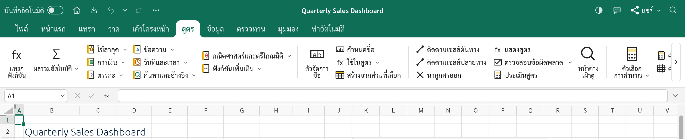
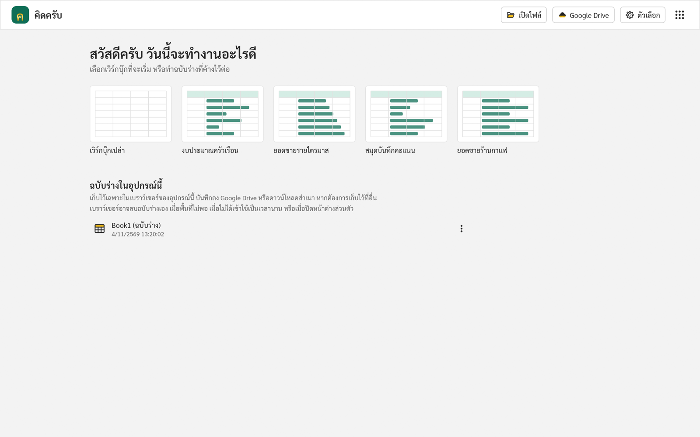

  

# คิดครับ · KhitKrub Web v0.3.0

**โปรแกรมตารางคำนวณภาษาไทยและภาษาอังกฤษ ใช้งานฟรีบนเว็บ**

**A free browser-based spreadsheet app for Thai and English.**

**[เปิดใช้งาน / Open KhitKrub](https://khitkrub.app/)** · [KrubOffice](https://kruboffice.app/) · [เขียนครับ · KhianKrub](https://khiankrub.app/) · [พูดครับ · PhutKrub](https://phutkrub.app/)

  

## ประกาศภาษาไทย

**คิดครับบนเว็บ (KhitKrub Web) v0.3.0** เปิดและบันทึกไฟล์ใน Google Drive ได้แล้ว พร้อมคลังฟังก์ชันในแท็บสูตรครับ

- **Google Drive** เชื่อมต่อ Google Drive ในคลิกเดียวแบบเดียวกับเขียนครับ เปิดตารางคำนวณ `.xlsx` จาก Drive แก้ไขแล้วกดบันทึก (Ctrl+S) ไฟล์เดิมใน Drive จะถูกบันทึกทับ หรือบันทึกเป็นสำเนาใหม่ก็ได้ โปรแกรมเข้าถึงเฉพาะไฟล์ที่คุณเลือกหรือที่โปรแกรมสร้างเท่านั้น
- **ฉบับร่างในอุปกรณ์นี้** เวิร์กบุ๊กใหม่ที่ยังไม่ได้บันทึกเป็นไฟล์หรือลง Google Drive เรียกว่าฉบับร่างอย่างชัดเจน หน้าเริ่มต้นแสดง **ชื่อ (ฉบับร่าง)** แถบชื่อด้านบนแสดง **(ฉบับร่าง) — บันทึกในอุปกรณ์นี้แล้ว** และเมื่อทุกอย่างถูกเก็บแล้ว ปิดแท็บได้โดยเบราว์เซอร์ไม่ถาม
- **ถามก่อนปิดแท็บเมื่องานจะหาย** ไฟล์ที่เปิดจากเครื่องหรือ Google Drive ที่ยังมีการแก้ไขค้างอยู่ เบราว์เซอร์จะถามก่อนปิดแท็บ
- **ถามบันทึกการเปลี่ยนแปลงเป็นภาษาไทย** หน้าต่างถามว่าจะบันทึกหรือไม่ ทั้งคำถามและปุ่ม บันทึก ไม่บันทึก ยกเลิก เป็นภาษาไทยแล้ว
- **เปิดไฟล์ CSV ที่วันที่ขึ้นต้นด้วยวัน** เช่น 31/05/2026 โปรแกรมดูทั้งคอลัมน์แล้วอ่านเป็นวัน/เดือน/ปีให้เอง
- **ตรึงช่องแล้วเลื่อนดูได้ไม่หาย** คอลัมน์ที่ตรึงไว้ยังแสดงข้อความ เส้นตาราง และเส้นขอบระหว่างเลื่อนดู
- **คลังฟังก์ชันในแท็บสูตร** ปุ่มหมวดฟังก์ชันพร้อมไอคอนสมุดสีต่าง ๆ ใช้ล่าสุด และแทรกฟังก์ชัน
- **ค้นหาและแทนที่เฉพาะช่วงที่เลือก**
- **สูตรจาก Google Sheets** ไฟล์ที่ส่งออกจาก Google Sheets เปิดแล้วได้สูตรเดิม
- **เลือกช่วงจากตารางในกล่องโต้ตอบ** เช่น หาค่าเป้าหมายและ Solver ย่อกล่องโต้ตอบลงขณะเลือกเซลล์ได้
- **แผนภูมิ รูปภาพ และรูปร่าง** เลือกได้แบบเดียวกัน มีจุดจับปรับขนาดแปดจุด
- **ขยายแถบสูตรได้** ลากขอบล่างของแถบสูตร
- **ทนทานขึ้น** จำกัดงานที่ไฟล์หรือสูตรผิดปกติสั่งให้ทำ เพื่อไม่ให้โปรแกรมค้างหรือปิดตัวเอง

**ที่ยังไม่เสร็จ** ชื่อฟังก์ชันในสูตรเป็นภาษาอังกฤษ ข้อความบางส่วนยังเป็นภาษาอังกฤษ (เช่น ชื่อไฟล์ตัวอย่างและเนื้อหาในตัวอย่าง) และยังไม่มีเลขไทย วันที่แบบ พ.ศ. หรือการอ่านจำนวนเงินเป็นตัวอักษร ยังไม่ได้ทดสอบบน iPad และโทรศัพท์มือถือ

## English announcement

**KhitKrub Web v0.3.0** adds Google Drive and a Function Library on the Formulas tab.

- **Google Drive.** Connect Google Drive in one click, as in KhianKrub: open an `.xlsx` workbook from Drive, edit it, and Save (Ctrl+S) puts it back over the same file, or save a new copy. The app sees only the files you pick or it creates.
- **Drafts on this device.** A new workbook not yet saved as a file or to Google Drive is plainly called a draft: the start screen lists **Name (draft)**, the title bar reads **(draft) — Saved on this device**, and once everything is kept the tab closes without the browser asking.
- **Asks before closing when work would be lost.** A file opened from this device or Google Drive with unsaved edits makes the browser ask before the tab closes.
- **Save Changes in Thai.** The question and the Save, Don't Save and Cancel buttons are in Thai.
- **CSV files with day-first dates**, such as 31/05/2026: the app looks at the whole column and reads them as day/month/year.
- **Frozen panes stay put.** Frozen columns keep their text, gridlines and borders while you scroll.
- **A Function Library on the Formulas tab:** category buttons with coloured book icons, Recently Used and Insert Function.
- **Find and Replace within a selection.**
- **Formulas from Google Sheets.** Files exported from Google Sheets open with their formulas.
- **Pick ranges from the sheet in dialogs** such as Goal Seek and Solver, collapsing the dialog while you select cells.
- **Charts, pictures and shapes** are selected the same way, with eight resize handles.
- **A taller formula bar.** Drag its bottom edge.
- **Sturdier.** The work an unusual file or formula can ask for is limited, so the app doesn't hang or close.

**Not done yet:** function names in formulas are English; some text is still English (such as the sample workbooks' own content); there are no Thai digits, Buddhist-era dates or baht-in-words yet; it has not been tested on iPads and phones.

## หน้าตาโปรแกรม / A look around

<table>
<tr>
<td width="50%" valign="top">
<b>หน้าเริ่มต้น / Start screen.</b> เวิร์กบุ๊กเปล่า ตัวอย่าง และฉบับร่างในเบราว์เซอร์ / A blank workbook, samples, and drafts kept in this browser.
</td>
<td width="50%" valign="top">
<b>ธีมมืด / Dark theme.</b> ตารางยังขาวเหมือนตอนพิมพ์ / The sheet stays white, as it will print.
</td>
</tr>
</table>

### ไอคอนชุดใหม่ / The new icons

  

## ความสามารถ / Features

| ภาษาไทย | English |
|---|---|
| สูตรและฟังก์ชันกว่า 500 ตัว อาร์เรย์แบบไดนามิก LET และ LAMBDA | 500+ functions, dynamic arrays, LET and LAMBDA |
| แผนภูมิ ตารางสรุปข้อมูล สปาร์กไลน์ และการจัดรูปแบบตามเงื่อนไข | Charts, pivot tables, sparklines and conditional formatting |
| เปิดและบันทึกไฟล์ Excel (`.xlsx`) และ CSV | Open and save Excel files (`.xlsx`) and CSV |
| เปิดและบันทึกไฟล์ใน Google Drive: เชื่อมต่อในคลิกเดียว กดบันทึกแล้วไฟล์เดิมใน Drive ถูกบันทึกทับ หรือบันทึกเป็นสำเนาใหม่ | Open and save files in Google Drive: connect in one click, Save puts the file back in Drive, or save a new copy |
| เมนูภาษาไทยและภาษาอังกฤษ เปิดครั้งแรกเป็นภาษาไทย บางส่วนยังเป็นภาษาอังกฤษ | Thai and English menus; the first visit opens in Thai; some text is still English |
| เมนูใช้ Sarabun ตัวอักษรไทยในเซลล์ใช้ TH Sarabun New | Menus use Sarabun; Thai letters in cells use TH Sarabun New |
| หน้าเริ่มต้นพร้อมฉบับร่างในอุปกรณ์นี้ ให้ทำต่อ ดาวน์โหลด หรือทิ้ง | A start screen with the drafts on this device, to keep working, download or discard |
| งานใหม่บันทึกเป็นฉบับร่างในอุปกรณ์นี้อัตโนมัติ ปิดแท็บได้โดยไม่หาย | New work is saved automatically as a draft on this device, so closing the tab loses nothing |
| ธีมสว่างและธีมมืด | Light and dark themes |

## แท็บสูตร / The Formulas tab

คลังฟังก์ชันจัดเป็นปุ่มหมวดพร้อมไอคอนสมุดสีต่าง ๆ มี ใช้ล่าสุด และ แทรกฟังก์ชัน ไฟล์ CSV ที่วันที่ขึ้นต้นด้วยวัน (31/05/2026) อ่านเป็นวัน/เดือน/ปีให้เอง ตรึงช่องแล้วเลื่อนดูได้ไม่หาย ค้นหาและแทนที่เฉพาะช่วงที่เลือกได้ และไฟล์ที่ส่งออกจาก Google Sheets เปิดแล้วได้สูตรเดิม / The Function Library is a set of category buttons with coloured book icons, Recently Used and Insert Function. CSV files with day-first dates (31/05/2026) are read day first, frozen panes keep their text while scrolling, Find and Replace works within a selection, and files exported from Google Sheets open with their original formulas.

## ฉบับร่างในอุปกรณ์นี้ / Drafts on this device

คิดครับบนเว็บไม่มีพื้นที่เก็บไฟล์บนเซิร์ฟเวอร์ เวิร์กบุ๊กใหม่ที่ยังไม่ได้บันทึกเป็นไฟล์หรือลง Google Drive จะเก็บเป็น **ฉบับร่าง** ในเบราว์เซอร์ของอุปกรณ์นี้โดยอัตโนมัติ แถบชื่อด้านบนแสดง **ชื่อ (ฉบับร่าง) — บันทึกในอุปกรณ์นี้แล้ว** เมื่อทุกอย่างถูกเก็บแล้ว ปิดแท็บได้ทันที หน้าเริ่มต้นจะแสดงในชื่อ **ชื่อ (ฉบับร่าง)** จนกว่าคุณจะทิ้ง ส่วนไฟล์ที่เปิดจากเครื่องหรือ Google Drive เบราว์เซอร์จะถามก่อนปิดแท็บหากยังมีการแก้ไขที่ยังไม่ได้บันทึก

There is no server storage. A new workbook not yet saved as a file or to Google Drive is kept automatically as a **draft** in this device's browser. The title bar reads **Name (draft) — Saved on this device** once everything is kept, and the tab can be closed straight away; the start screen lists it as **Name (draft)** until you discard it. For a file opened from this device or Google Drive, the browser asks before the tab closes with unsaved edits.

- หากเบราว์เซอร์ไม่รับปากว่าจะเก็บข้อมูลไว้ หน้าเริ่มต้นจะเตือนว่าอาจลบฉบับร่างเองได้ / If the browser does not agree to keep the site's storage, the start screen warns that it may remove drafts by itself.

## เริ่มใช้งาน / Getting started

1. เปิด / Visit **[khitkrub.app](https://khitkrub.app/)** บนคอมพิวเตอร์ / on a computer.
2. ที่หน้าเริ่มต้น เลือกเวิร์กบุ๊กเปล่า ตัวอย่าง หรือฉบับร่าง หรือกด **เปิดไฟล์** / On the start screen, pick a blank workbook, a sample or a draft, or press **Open file**.
3. บันทึกงานผ่าน **ไฟล์ → บันทึก** แล้วเก็บไฟล์ไว้ในเครื่อง / Save through **File → Save** and keep the file on your device.

## ที่มา / Credits

KhitKrub is Chanon Sarasuk's Thai adaptation of [GridCraft](https://github.com/storytold/gridcraft) by the ArtCraft team (MIT or Apache-2.0, at your option), one of the apps in [KrubOffice](https://kruboffice.app/). It is not an ArtCraft product and is not affiliated with Microsoft. The screenshots are taken from the running app and show its built-in sample workbooks (original content). This repository holds the compiled site only; the source code is private. Third-party components keep their own licences: see `ATTRIBUTION.md`, `NOTICE`, and `fonts/` (Sarabun: SIL OFL 1.1; TH Sarabun New: GPL with the font exception).

Prepared from version **0.3.0**, source commit `93c079b5`.
