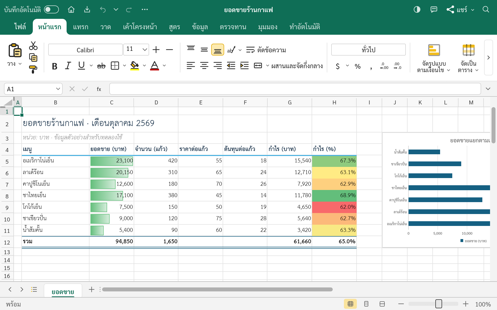
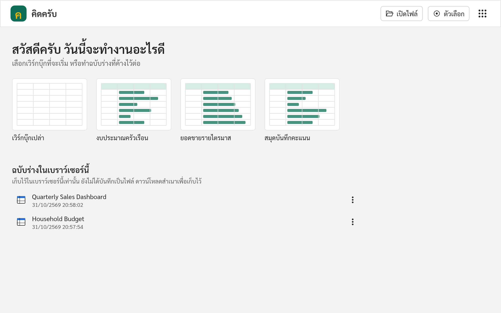
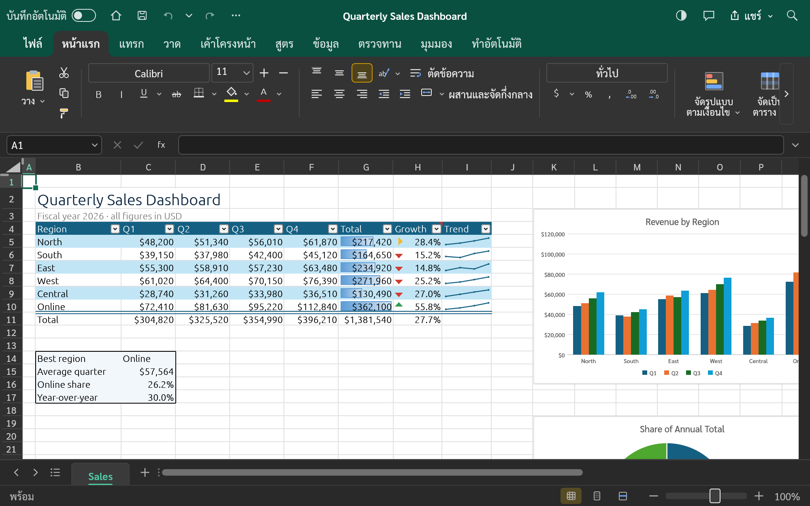
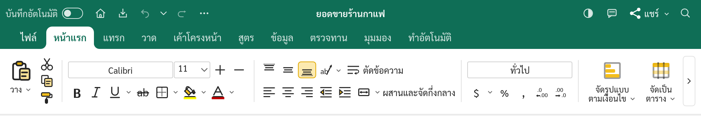

  

# คิดครับ · KhitKrub Web v0.2.0

**โปรแกรมตารางคำนวณภาษาไทยและภาษาอังกฤษ ใช้งานฟรีบนเว็บ**

**A free browser-based spreadsheet app for Thai and English.**

**[เปิดใช้งาน / Open KhitKrub](https://khitkrub.app/)** · [KrubOffice](https://kruboffice.app/) · [เขียนครับ · KhianKrub](https://khiankrub.app/) · [พูดครับ · PhutKrub](https://phutkrub.app/)

  

## ประกาศภาษาไทย

**คิดครับบนเว็บ (KhitKrub Web) v0.2.0** ไอคอนชุดใหม่และริบบิ้นแบบเดียวกับเขียนครับครับ

- **ไอคอนชุดใหม่** ไอคอนบนริบบิ้นวาดใหม่ทั้งชุด เส้นสีเข้มอ่านง่าย แต้มสีทองเฉพาะส่วนสำคัญ ใช้ชุดเดียวกับเขียนครับและพูดครับ ปุ่มเดียวกันจึงหน้าตาเหมือนกันทุกโปรแกรม
- **ริบบิ้นแบบเดียวกับเขียนครับ** ทุกแท็บมีไอคอนใหญ่ขึ้น ปุ่มเรียงกึ่งกลางแถบ และระยะห่างเท่ากันทุกกลุ่ม
- **โลโก้ใหม่** ตัว ค สีทองบนพื้นสีเขียวอมน้ำเงิน แบบกระจกมีประกาย ทั้งหน้ารอเปิดโปรแกรมและหน้าเริ่มต้น
- รูปไอคอนที่แทรกไว้ในเวิร์กบุ๊กยังหน้าตาเหมือนเดิม งานที่ทำไว้แล้วจึงไม่เปลี่ยน

**ที่ยังไม่เสร็จ** ชื่อฟังก์ชันในสูตรเป็นภาษาอังกฤษ ข้อความบางส่วนยังเป็นภาษาอังกฤษ (เช่น ชื่อไฟล์ตัวอย่างและเนื้อหาในตัวอย่าง) และยังไม่มีเลขไทย วันที่แบบ พ.ศ. หรือการอ่านจำนวนเงินเป็นตัวอักษร ยังไม่ได้ทดสอบบน iPad และโทรศัพท์มือถือ

## English announcement

**KhitKrub Web v0.2.0** has new icons and KhianKrub's ribbon.

- **New icons.** Every ribbon icon has been redrawn: dark, easy-to-read lines with a touch of gold where it matters. It's the same set as KhianKrub and PhutKrub, so the same button looks the same in every app.
- **KhianKrub's ribbon.** Every tab has larger icons, buttons centred in the ribbon, and even spacing in every group.
- **A new logo.** A gold ค on teal with a glass shine, on the loading screen and the start screen.
- Icons you've inserted into a workbook keep their look, so your existing work doesn't change.

**Not done yet:** function names in formulas are English; some text is still English (such as the sample workbooks' own content); there are no Thai digits, Buddhist-era dates or baht-in-words yet; it has not been tested on iPads and phones.

## หน้าตาโปรแกรม / A look around

<table>
<tr>
<td width="50%" valign="top">
<b>หน้าเริ่มต้น / Start screen.</b> เวิร์กบุ๊กเปล่า ตัวอย่าง และฉบับร่างในเบราว์เซอร์ / A blank workbook, samples, and drafts kept in this browser.
</td>
<td width="50%" valign="top">
<b>ธีมมืด / Dark theme.</b> ตารางยังขาวเหมือนตอนพิมพ์ / The sheet stays white, as it will print.
</td>
</tr>
</table>

### ไอคอนชุดใหม่ / The new icons

  

## ความสามารถ / Features

| ภาษาไทย | English |
|---|---|
| สูตรและฟังก์ชันกว่า 500 ตัว อาร์เรย์แบบไดนามิก LET และ LAMBDA | 500+ functions, dynamic arrays, LET and LAMBDA |
| แผนภูมิ ตารางสรุปข้อมูล สปาร์กไลน์ และการจัดรูปแบบตามเงื่อนไข | Charts, pivot tables, sparklines and conditional formatting |
| เปิดและบันทึกไฟล์ Excel (`.xlsx`) และ CSV | Open and save Excel files (`.xlsx`) and CSV |
| เมนูภาษาไทยและภาษาอังกฤษ เปิดครั้งแรกเป็นภาษาไทย บางส่วนยังเป็นภาษาอังกฤษ | Thai and English menus; the first visit opens in Thai; some text is still English |
| เมนูใช้ Sarabun ตัวอักษรไทยในเซลล์ใช้ TH Sarabun New | Menus use Sarabun; Thai letters in cells use TH Sarabun New |
| หน้าเริ่มต้นพร้อมฉบับร่างในเบราว์เซอร์ ให้เขียนต่อ ดาวน์โหลด หรือทิ้ง | A start screen with the drafts kept in this browser, to keep working, download or discard |
| ธีมสว่างและธีมมืด | Light and dark themes |

## เริ่มใช้งาน / Getting started

1. เปิด / Visit **[khitkrub.app](https://khitkrub.app/)** บนคอมพิวเตอร์ / on a computer.
2. ที่หน้าเริ่มต้น เลือกเวิร์กบุ๊กเปล่า ตัวอย่าง หรือฉบับร่าง หรือกด **เปิดไฟล์** / On the start screen, pick a blank workbook, a sample or a draft, or press **Open file**.
3. บันทึกงานผ่าน **ไฟล์ → บันทึก** แล้วเก็บไฟล์ไว้ในเครื่อง / Save through **File → Save** and keep the file on your device.

## ที่มา / Credits

KhitKrub is Chanon Sarasuk's Thai adaptation of [GridCraft](https://github.com/storytold/gridcraft) by the ArtCraft team (MIT or Apache-2.0, at your option), one of the apps in [KrubOffice](https://kruboffice.app/). It is not an ArtCraft product and is not affiliated with Microsoft. The screenshots are taken from the running app and show its built-in sample workbooks (original content). This repository holds the compiled site only; the source code is private. Third-party components keep their own licences: see `ATTRIBUTION.md`, `NOTICE`, and `fonts/` (Sarabun: SIL OFL 1.1; TH Sarabun New: GPL with the font exception).

Prepared from version **0.2.0**, source commit `1fe5d2e1`.
